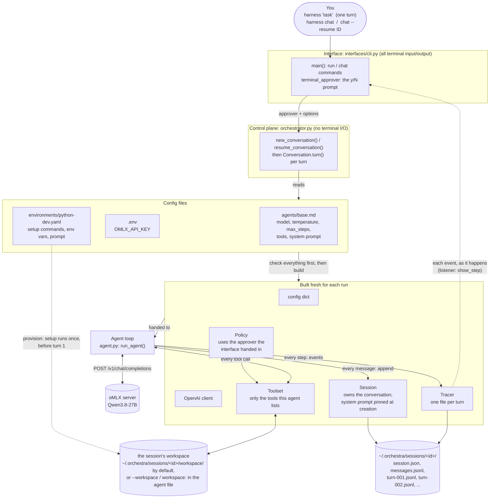
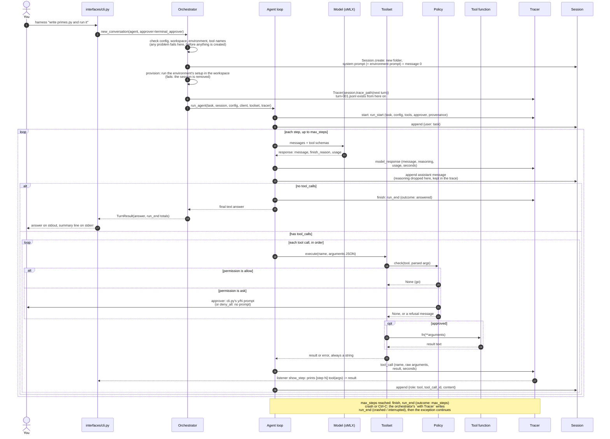
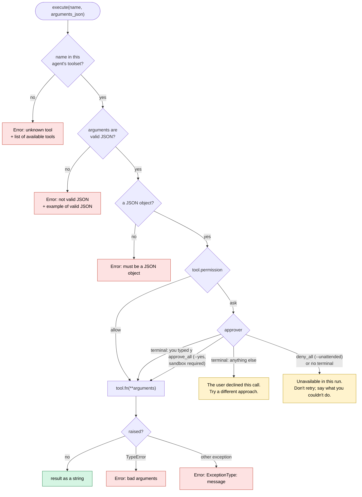
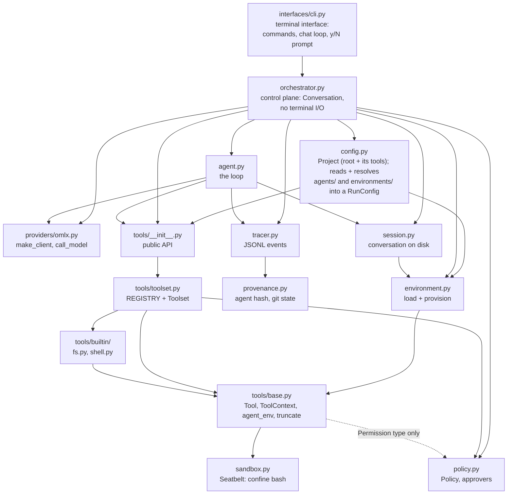

# How the harness works

A picture of the agent as it exists today, kept up to date as the code changes.
Diagrams are [Mermaid](https://mermaid.js.org/), which GitHub renders automatically.

**Last updated:** 2026-10-22, sandbox rules come from the environment file

---

## 1. The big picture

One command builds everything the agent needs, then hands it over. The orchestrator
wires things together; the agent loop does the work; every tool call passes through
one checkpoint.



---

## 2. One turn, step by step

`harness "task"` is a new session with one turn. `harness chat` loops: read a line, run a
turn, print the answer, repeat; every turn adds to the same session. `chat --resume ID`
reloads a saved session (repairing an interrupted history) and keeps going. The diagram
shows one turn of a new session; a resumed or later turn skips the creation steps.

The model is stateless: every turn sends the **whole** conversation. The loop ends
when the model replies without asking for a tool, or when `max_steps` runs out.



---

## 3. Inside `Toolset.execute`: the one checkpoint

Every tool call goes through these checks in order. **Nothing here raises:** each
failure becomes text the model reads next turn, so it can fix its own mistake.
Malformed calls are rejected *before* a human is ever asked.



---

## 4. The tools

| Tool | Permission | What it does | Guardrails |
|---|---|---|---|
| `read_file` | allow | Return a file's text | Paths can't leave the workspace; binary/empty files say so; long output truncated (head + tail) |
| `write_file` | allow | Create or overwrite a file | Same path rule; creates parent folders |
| `bash` | **ask** | Run a shell command in the workspace | Approval first; **runs in the macOS sandbox** (section 6); **allowlisted environment only** (no API keys, not the harness's own Python); stdin closed; timeout kills the whole process group; output truncated; exit code always reported |

Every tool function takes a `ToolContext` first (today: just the workspace path). `Toolset`
passes it on every call; it isn't in any schema, so the model can neither see nor set it.

**Which workspace:** `--workspace PATH` wins, then `workspace:` in the agent file (relative to
the project root), else a fresh empty folder inside the session. A given folder must already
exist. The session records its workspace when created, so resuming works on the same files.

Tools come from the built-ins plus the project's own (`Project(root, extra_tools=...)`, passed
to `new_conversation()`), so a project adds tools without editing the harness. An agent only gets the tools its `.md` file lists. A tool it wasn't given can't run,
even if the model invents a call to it.

---

## 5. Environments: how a workspace is set up

An environment is a config file the **harness** applies before the agent starts, so setup is
deterministic and costs the agent no steps. Setup commands run without approval: they come
from a file you wrote (trusted), not from the model (untrusted).

```yaml
# environments/python-dev.yaml          (agents/base.md has: environment: python-dev)
description: Python 3.12 virtualenv with pytest
setup:                                  # run in the workspace, in order; any failure stops
  - uv venv --quiet --python 3.12 .venv
  - uv pip install --quiet --python .venv pytest
env:                                    # added to the agent's commands; PATH is prepended
  PATH: "{workspace}/.venv/bin"
  VIRTUAL_ENV: "{workspace}/.venv"
prompt: |                               # appended to the system prompt automatically
  Your workspace has a Python 3.12 virtualenv in .venv with pytest installed. ...
```

- **Which one:** `--environment NAME` (or `none`) wins over `environment:` in the agent file.
- **It belongs to the workspace:** provisioning writes `<workspace>/.harness/environment.json`
  (name + version) last, after every command succeeded. Same version already there: skipped
  (a shared workspace is set up once). A different version: refused, never set up over the top.
- **Same environment for commands and setup:** both run with `ToolContext.command_env()`, the
  allowlisted variables plus the environment's, so neither sees the harness's secrets.
- **Provenance:** the resolved config records `environment: {name, version}`, where the version
  hashes the spec *and* its template files, so changing an environment changes `agent_version`.

---

## 6. The sandbox: what bash commands can touch

`bash` asks `ctx.sandbox` to `prepare()` each command. On macOS the default is **Seatbelt**:
the command runs under `sandbox-exec` with rules generated for its workspace, and the
operating system enforces them. (`--no-sandbox` runs commands unconfined.)

| | Allowed | Blocked |
|---|---|---|
| **Write** | the workspace, `/dev` | everywhere else (`/tmp`, your home folder, the harness) |
| **Read contents** | everything outside your home folder; in home only the workspace and the environment's `sandbox.readable` (python-dev: uv's Pythons) | the rest of home: `~/.zshrc`, `~/.ssh`, the harness `.env`, other sessions, folder listings |
| **Check existence** | everywhere (tools like pytest and git walk up the tree looking for config files) | |
| **Network** | local sockets; the internet if the environment sets `sandbox.network: true` | the internet, by default |

**Who decides what:** the interface decides *whether* there's a sandbox (Seatbelt, or none with
`--no-sandbox`); the session's environment decides *what its commands need* (the `sandbox:`
section of its file, recorded in `session.json` when the session is created). `build_toolset`
combines them: `sandbox.with_rules(session.sandbox_rules)`.

Temp files go to `<workspace>/.tmp` (`TMPDIR`). Each run's trace records `sandbox` in `run_start`.

**`--yes` (`approve_all`) is only allowed with the sandbox on**: with nobody approving, the
sandbox is the safety net. `require_sandbox_for_auto_approval()` in `policy.py` is the one
place that rule lives; the CLI calls it for a clear error, and the orchestrator calls it
again before creating anything, so code that skips the CLI can't bypass it.
`read_file`/`write_file` don't use the sandbox (they run inside the harness); `_resolve()`'s
path check confines them instead.

**Why sessions live in `~/.orchestra/sessions`, outside this project:** tools walk *up* from
their folder looking for config. A workspace inside the harness project made git treat it as
part of the harness repository, and pytest read the harness's `pyproject.toml`. Outside, each
workspace is a clean folder. `~/projects/orchestra-sessions` is a symlink to it.

---

## 7. Chat: many turns, one session

```text
$ harness chat                        $ harness chat --resume 2026-10-20T18-55-51_base_66ec
you> Create fruits.txt ...            you> which one did you add last time?
you> Add a fourth fruit to it ...     -> "mango", remembered from the earlier process
```

- **What's fixed when the session is created:** system prompt, workspace, environment.
  Resuming can't change them (`--agent`/`--workspace`/`--environment` with `--resume` is an error).
- **What comes from the agent file each time:** model, temperature, max_steps, tools; each
  turn's trace records exactly what it used.
- **Ctrl-C during a turn** stops only that turn: `session.repair()` answers any tool call left
  without a result (the API would reject the next request otherwise), and the prompt comes back.
  **An error** (e.g. the model server going away) does the same. Ctrl-C/Ctrl-D/`/exit` at the
  prompt leaves, printing the command to resume.

---

## 8. What the model sees: the conversation grows

From a real run of `"Write primes.py that prints the first 10 primes, run it"`:

```text
request 1: [system] [user]
request 2: [system] [user] [assistant: write_file] [tool: Wrote 381 characters]
request 3: [system] [user] [assistant: write_file] [tool: ...] [assistant: bash] [tool: [2, 3, 5, ... 29] (exit code 0)]
answer:    "Done! I created primes.py and ran it. The output was ..."
```

History is append-only: each request starts with the previous one, unchanged. That's
what lets oMLX reuse its prompt cache instead of re-reading the whole conversation.

The history lives in the **session**, which owns it: `session.messages` is read-only, and
`session.append()` is the only way to add to it, saving each message to `messages.jsonl`
as it happens. A second turn in the same session starts from all of the first:

```text
turn 2, request 1: [system] [user: turn 1 task] ... [assistant: turn 1 answer] [user: turn 2 task]
```

**Session vs. trace:** the session is the agent's *memory* (exactly what the model sees,
and later compaction may rewrite it); the trace is the *record* (everything, never rewritten).

```text
~/.orchestra/sessions/2026-10-20T14-13-59_base_8569/     (also via ~/projects/orchestra-sessions)
  session.json      id, agent, agent_version, workspace, created: written once, never changed
  messages.jsonl    the conversation, one message per line
  turn-001.jsonl    trace of turn 1; the trace files are the only record of which turns happened
  workspace/        where the agent works (unless the session was given another folder)
```

---

## 9. What a trace records

**The trace is also how interfaces see progress.** The agent loop never prints: it reports
each event to the tracer, which writes it to the file and then calls any *listeners* with it.
`Conversation.turn(task, on_event=...)` is how an interface attaches one; the terminal's
`show_step` prints each `tool_call` as it finishes. A web UI would attach a listener that
streams events to the browser, with no change to the agent loop.

One JSONL file per turn, inside its session: `~/.orchestra/sessions/<id>/turn-001.jsonl`.
The format is defined in one place, `tracer.py`: the agent reports what happened
(`start`, `model_response`, `tool_call`, `finish`), and the tracer decides what's recorded.
One tracer = one turn = one file. The orchestrator owns it with `with Tracer(path) as tracer:`,
so even a crash or Ctrl-C ends the trace with exactly one `run_end`.
Each line is flushed as it happens, so a crashed run still leaves its trace.
From the real primes run above:

```text
run_start       agent=base  approver=terminal_approver  tools=[read_file, write_file, bash]
model_response  step 1  7.0s  prompt=623 tokens  cached=0  out=204  -> write_file
                reasoning: "The user is asking me to write a primes.py ..."
tool_call       step 1  write_file -> "Wrote 381 characters to primes.py."
model_response  step 2  2.1s  prompt=816  cached=0  out=43  -> bash
tool_call       step 2  bash -> "[2, 3, 5, 7, 11, 13, 17, 19, 23, 29] (exit code 0)"
model_response  step 3  3.9s  prompt=903  cached=0  out=101  -> final answer
run_end         outcome=answered  steps=3  13.0s
```

| Event | When | Key fields |
|---|---|---|
| `run_start` | once, first | task, full config (incl. system prompt), tool schemas, approver, **provenance** (below) |
| `model_response` | every model call | message, **reasoning** (dropped from history, kept here), finish_reason, model (as reported by the server), usage (tokens, cache, oMLX timings), seconds |
| `tool_call` | every tool call | id, name, **raw** arguments string, result, seconds |
| `run_end` | once, last | outcome: `answered` / `max_steps` / `crashed` / `interrupted`; answer or error; steps; seconds |

**Provenance**: what produced a run, so runs can be filtered later (evals, fine-tuning data).
A hash *identifies* content; it doesn't store it.

| Field | Meaning | Recoverable? |
|---|---|---|
| `agent_version` | 12-char hash of the agent definition (name excluded): same content, same version | Yes: the full definition is in `run_start.config` |
| `harness.commit` / `harness.dirty` | git commit of the harness code; whether there were uncommitted changes | Via `git checkout`, only if `dirty` is false |
| `config.model` (+ `model` per response) | the model asked for, and the one the server says answered | Only if the same weights still exist |

---

## 10. How the code is organized

```text
src/harness/
  interfaces/   cli.py          where a human talks to the harness (terminal now; a web UI later)
  orchestrator.py               wiring: Conversation, new/resume, no terminal I/O
  agent.py                      the loop
  providers/    omlx.py         reaching the model server: make_client, call_model
  tools/        base.py, toolset.py, builtin/{fs,shell}.py
  policy.py  config.py  environment.py  session.py  tracer.py  provenance.py  sandbox.py
```

Arrows mean "imports". They only point one way: nothing imports an interface,
nothing but the interface imports the orchestrator,
tools never import the machinery around them, and `policy.py` imports nothing at runtime.



---

## Not built yet

What's planned, in rough order. Each becomes a diagram change when it lands.

- **Reading traces:** `harness show <trace>` to print a past run readably, and a summary line (steps, tokens, cache hits, time) at the end of each run.
- **More tools:** `list_dir`, `edit`, eventually `web_search` and MCP servers.
- **Context management:** compaction when the conversation nears the 32k window.
- **Provider adapters:** oMLX and native Anthropic behind one interface.
